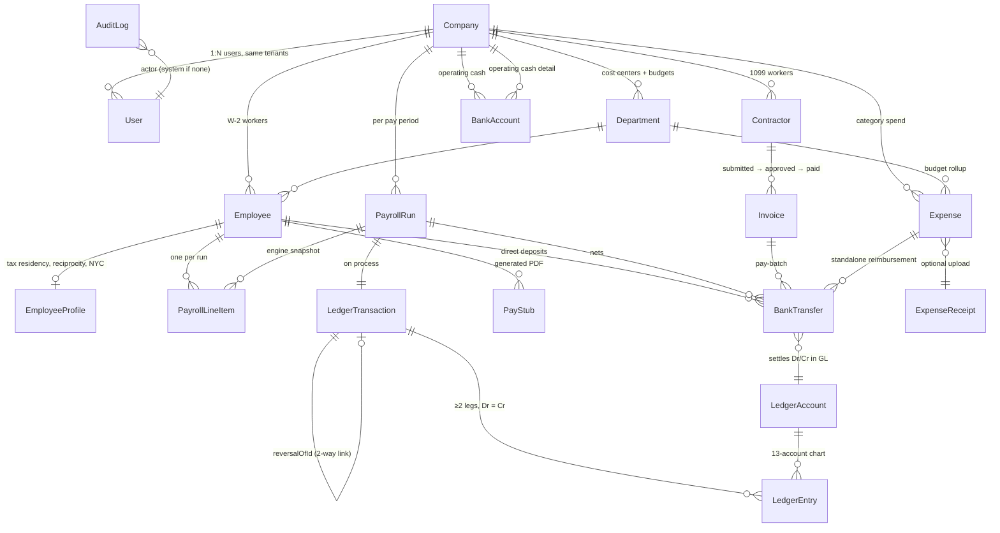
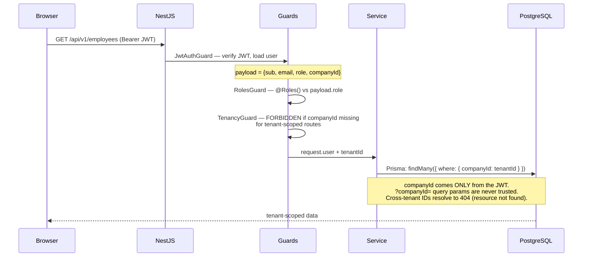
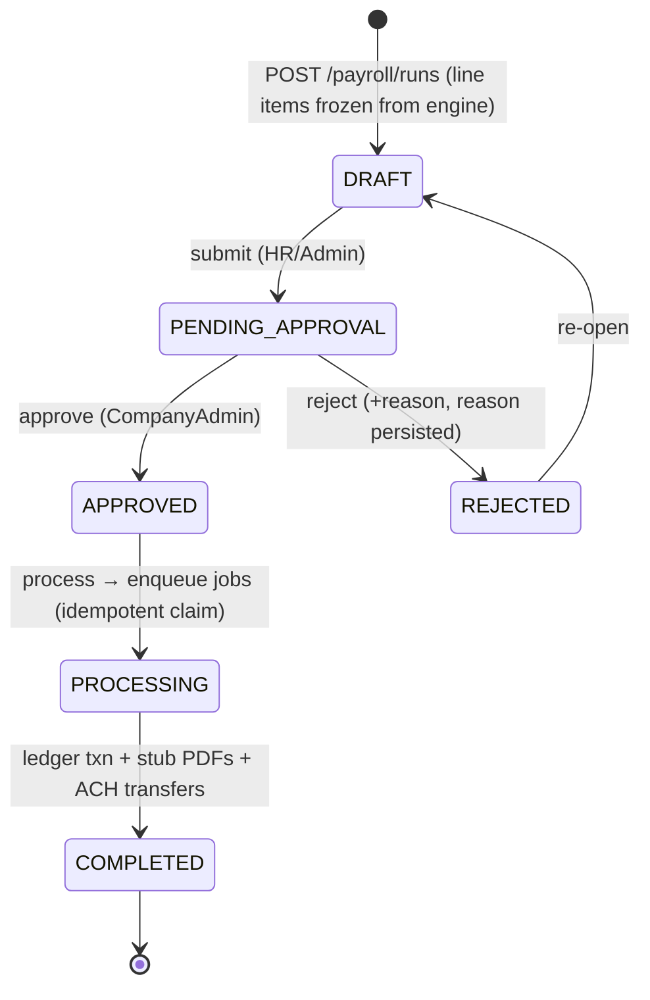
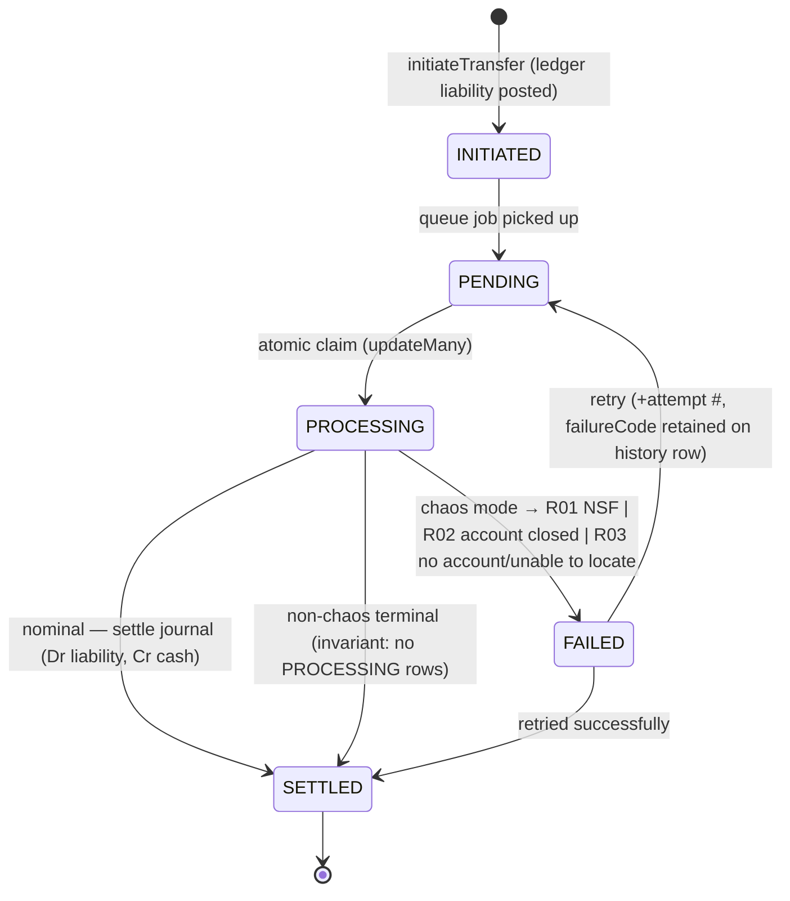
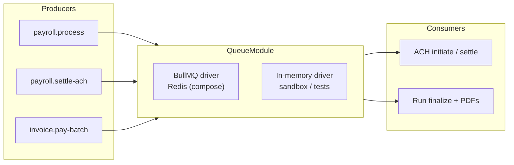

# PayLedger — Architecture

> **Simulated fintech platform for portfolio demonstration. No real money is moved and no real tax filings occur.**

PayLedger is a full-stack payroll & contractor-payment platform: NestJS + Prisma + PostgreSQL +
BullMQ on the backend, Next.js 15 + Tailwind + shadcn-style components + Framer Motion on the
frontend, packaged with Docker Compose. It is architecturally shaped like a production fintech
system — strict multi-tenancy, RBAC at the API, an immutable double-entry ledger, a real tax
calculation engine, idempotent job processing — while every external effect (ACH settlement,
tax filing, banking) is explicitly simulated and labeled as such.

---

## 1. System overview

```mermaid
flowchart LR
    subgraph Browser["Browser"]
        U[User / Role]
    end

    subgraph Web["Next.js 15 · apps/web"]
        R[App Router pages<br/>17 routes · role-aware shell]
        C[cmdk palette ⌘K]
        M[Framer Motion<br/>page transitions · countups · springs]
        RC[Recharts dashboards]
        W[Sticky simulation banner]
    end

    subgraph API["NestJS 11 · apps/api (prefix /api/v1)"]
        AUTH["AuthModule<br/>JWT + bcrypt + Roles guards"]
        PAY["PayrollModule<br/>preview · workflow · PDF stubs"]
        TAX["TaxEngineModule<br/>2024 federal/state"]
        LED["LedgerModule<br/>double-entry, append-only"]
        ACH["AchModule<br/>state machine · chaos mode"]
        INV["InvoicesModule · ExpensesModule<br/>budgets"]
        CMP["ComplianceModule<br/>941 / W-2 / SUTA"]
        AUD["AuditLogModule<br/>activity viewer"]
        DSH["DashboardModule<br/>4 role variants"]
        Q["QueueModule<br/>BullMQ · memory fallback"]
    end

    subgraph Data["Data"]
        PG[(PostgreSQL 15+<br/>Prisma 7 · 3 migrations<br/>ledger + audit DB triggers)]
        RD[(Redis <i>(BullMQ, optional)</i>)]
        FS[(uploads/ · pdfs via pdf-lib)]
    end

    U --> R
    R -->|relative /api calls| W
    W -->|Next.js rewrites| API
    AUTH --> PG
    PAY --> TAX
    PAY --> LED
    PAY --> ACH
    PAY --> Q
    Q -->|jobs: settle · process| ACH
    Q -->|jobs: settle-ach| PAY
    INV --> LED
    INV --> ACH
    Q -.->|optional| RD
    LED --> PG
    CMP --> PG
    AUD --> PG
    DSH --> PG
```

**Request path:** the browser only ever calls relative `/api/...` URLs. Next.js `rewrites`
forwards them to the API service (compose: `http://api:3001`), so no localhost/origin coupling
exists in client code, CORS never applies, and cookies/JWTs stay same-origin.

---

## 2. Domain model



**Money convention:** every monetary column is an integer in **cents**; floats are never persisted.
Balances are derived by `groupBy` aggregates over `LedgerEntry` — **no balance column exists on
any account**, so a balance can never silently drift from the postings.

---

## 3. Tenancy & RBAC

### Request lifecycle



### Role matrix (enforced in guards, mirrored by the UI nav)

| Capability | PLATFORM_ADMIN | COMPANY_ADMIN | HR_MANAGER | ACCOUNTANT | EMPLOYEE | CONTRACTOR |
|---|:-:|:-:|:-:|:-:|:-:|:-:|
| platform:manage (all companies) | ✅ | — | — | — | — | — |
| companies / departments / budgets read | ✅ | ✅ | ✅ | ✅ | — | — |
| employees (write) | ✅ | ✅ | ✅ | — | — | — |
| employees (read) | ✅ | ✅ | ✅ | ✅ | — | — |
| payroll (create/approve/process) | ✅ | ✅ | — | — | — | — |
| payroll (read) | ✅ | ✅ | ✅ | ✅ | — | — |
| my paystubs | ✅ | ✅ | ✅ | ✅ | ✅ | — |
| expenses (submit own) | ✅ | ✅ | ✅ | ✅ | ✅ | — |
| expenses (approve) | ✅ | ✅ | ✅ | — | — | — |
| invoices (submit) | ✅ | ✅ | ✅ | ✅ | — | ✅ |
| invoices (approve / pay-batch) | ✅ | ✅ | — | — | — | — |
| audit / compliance | ✅ | ✅ | read | read | — | — |
| transfers (retry) | ✅ | ✅ | — | — | — | — |

Enforcement layers (all in the API — the UI only mirrors `navFor(role)`):

1. **JWT** — tenancy claim bound at login; no client-supplied tenant IDs anywhere.
2. **`@Roles()` + `RolesGuard`** — per-route role sets, checked on every request.
3. **Service-layer scoping** — every Prisma call takes `companyId` from `req.user`
   (pragmatic for Prisma 7 — instead of a Prisma extension, controllers pass the JWT tenant and
   accessors verify it; cross-tenant IDs ⇒ 404, not data).
4. **Tests** — `test/tenancy-rbac.spec.ts` (8/8) proves cross-tenant 404s and role denials
   (403) for every sensitive group.

---

## 4. Payroll run engine & workflow



- **Preview** (`POST /payroll/preview`) runs the tax engine over all active employees for a
  period — no persistence — and flags `hasNegativeNet` so UIs can halt creation.
- **Creation** re-runs the engine per employee and persists immutable `PayrollLineItem` snapshots
  (federal, state, FICA, deductions, reimbursements, net) — the run is a frozen document.
- **Idempotency**: `process` transitions only on an atomic `updateMany` claim
  (`APPROVED → PROCESSING`); a double-click or double-worker enqueue finds the claim gone and
  returns the existing state. Queue jobs additionally check status before acting.
- **Processing** posts one journal transaction, generates pay-stub PDFs (pdf-lib), and creates one
  ACH transfer per positive net (`DEFER_TO_PAYROLL` reimbursements merged into nets).
- Employee-facing `GET /payroll/my-paystubs` + `GET .../stubs/:employeeId/pdf` (watermarked).

### What the engine computes (per period)

```
annual = rate (salaried) | hourly × 40 × 26          (biweekly)
federal  = Σ bracket slices (2024 MFJ/HOH/Single) − annualized FTC
FICA Ss  = 6.2% up to $168,600 · FICA Med = 1.45% (+0.9% over $200k)
state    = FLAT(Y) | FLAT(NY + NYC surcharge ≥$120k) | progressive(TAXY) | FLAT-with-floor(PATR)
           NJ: graduated brackets with federal-tax deduction
period   = annualized ÷ 26 (federal uses annualized − 2×FED_DEDUCTION per period)
```

Coverage: **23 dedicated unit tests, 96.64 % statements** (gate ≥ 90 %), exercising TX/CA/PA/NY
(+NYC)/NJ, MFJ and HOH, ceilings and floor behavior.

---

## 5. ACH simulation (state machine)



- **Exactly-once** settlement: `updateMany({id, status in terminal?})` claim prevents double
  settle even with concurrent workers (tested).
- **Chaos mode** is per-company (`Company.chaosMode`) and deterministic-friendly: ~8 % of
  settlements fail with a classic NACHA code, the UI surfaces `R01/R02/R03` badges with
  human-readable meanings, and failures are retriable and journaled.
- Settlement delays are environment-tunable (`ACH_SETTLE_DELAY_MS`); tests use 150 ms, demo
  uses seconds, seeding drives the transitions manually for reproducibility.
- **Invariant tested**: `transit == inflight` and `IN_PROGRESS ⊆ {PENDING, PROCESSING}`.

---

## 6. Double-entry ledger

- **Chart of accounts (13):** `OPERATING_CASH, ACCOUNTS_RECEIVABLE, PAYROLL_EXPENSE,
  WAGES_EXPENSE, FICA_EXPENSE, UNEMPLOYMENT_EXPENSE, CONTRACTOR_EXPENSE, REVENUE,
  REIMBURSABLE_EXPENSE, ACCRUED_LIABILITY, ACCT_PAYABLE, OWNER_EQUITY, SUSPENSE`.
- **Posting rules (DB-enforced, migration `20261028000001_ledger_guardrails`):**
  - before-INSERT trigger: `debitAmount = 0 XOR creditAmount = 0` — never both, never neither;
  - before-INSERT trigger: legs sum to a per-transaction balance of exactly 0 (ΣDr = ΣCr);
  - before-UPDATE/DELETE trigger on `LedgerEntry`: **RAISE EXCEPTION — entries are immutable**;
  - `LedgerEntry.transactionId` is `ON DELETE RESTRICT` — history can't be dropped away.
- **Corrections** only via `POST /ledger/transactions/:id/reverse` → appends a mirrored
  transaction and writes a **two-way link** (`reversalOfId` ↔ `reversedByTransactionId`).
  Reversing a reversal is rejected (circular link blocked in code + tested).
- **Balances** = `groupBy` sums with natural-side sign (debit-normal positive, credit-normal
  negative); trial balance endpoint reports `balanced: true` (tested).
- **Sources of truth tested:** company creation → opening balances (`Dr Cash / Cr Equity`),
  payroll → `Dr PAYROLL_EXPENSE/WAGES/FICA/UNEMPLOYMENT / Cr ACCRUED_LIABILITY`, ACH settle →
  `Dr ACCRUED_LIABILITY / Cr OPERATING_CASH`, invoice pay-batch → `Dr ACCT_PAYABLE / Cr CASH`,
  reimbursements, reversal net-zero.
- Coverage: **ledger module 93.2 % stmts / 94.03 % lines** (gate ≥ 80 %).

---

## 7. Jobs & queues



- `QUEUE_DRIVER=auto|bullmq|memory`: `auto` probes Redis once at boot (600 ms) and falls back
  to the **in-memory driver** — identical job contract, no Redis dependency in the sandbox/CI;
  compose sets `QUEUE_DRIVER=bullmq`.
- Job handlers are idempotent (status claims before side effects), and every job that touches
  the ledger does so only through `LedgerService.postTransaction`.

---

## 8. Compliance & audit

- **Forms** — `941` (quarterly, real ledger line totals), `W-2` (per-employee, prior-year YTD),
  `SUTA` (wage base $10k, 2.70 %): rendered with pdf-lib and stamped
  **“SIMULATED — NOT FOR FILING”**. RBAC: `compliance:generate` (CompanyAdmin/PlatformAdmin)
  vs `compliance:read` (HR/Accountant).
- **Jurisdiction check** — `EmployeeProfile.residenceState` vs `Employee.workState`
  (PA/NJ/NY/CA reciprocity, NYC surcharge flag) surfaced through
  `GET /compliance/jurisdiction-check` with per-employee expectation notes.
- **Filing calendar** — generated due dates with `upcoming | simulated_filed | overdue` states
  (the demo seed simulates already-filed quarters).
- **AuditLog** — immutable activity trail: `record(actor, action, entityType, entityId, before,
  after)` written by services on every significant mutation (login, company create, employee
  create/archive, expense/invoice approve/reject, ACH retry, payroll transitions…).
  Migration triggers make UPDATE/DELETE impossible at the database level; the API surface is
  read-only (`GET /audit?action=&entityType=&page=`); verified by tests.
  `beforeState/afterState` are stored as JSON (column type `Json?`, cast at call sites).

---

## 9. Frontend architecture

```mermaid
flowchart TD
    subgraph Root["app/ (root)"]
        L[layout.tsx — fontsource Inter,<br/>SessionProvider · Toaster · banner sticky z-60]
        T[template.tsx — PageTransition crossfade<br/>respects prefers-reduced-motion]
        LG[login — split hero, one-click demo roles]
    end
    subgraph Shell["(app) layout — sidebar + ⌘K palette"]
        D[dashboard · 4 role variants]
        P[payroll + payroll/[id] lifecycle]
        E[employees · contractors · departments]
        F[ledger · transfers]
        X[expenses · invoices]
        C[compliance · audit · settings]
    end
    LG -->|JWT → sessionStorage| Shell
    Shell --> D
    Shell --> P
```

- **Data layer** — `useApi<T>(path, {pollMs})`: tiny SWR-lite hook (revalidation on focus,
  polling for live pages like dashboard/ledger/transfers, `ApiError`, global 401 → `/login`).
  All calls relative (`/api/...`); token attached from session store.
- **RBAC mirror** — `navFor(role)` reproduces the guard matrix; hidden UI is defense-in-depth
  only, never the enforcement point (the API rejects anyway).
- **Design system** — emerald `#10b981` brand, slate-50 canvas, white `shadow-sm rounded-xl`
  cards, 4px spacing grid, Plus-Jakarta-style display via Inter + `tabular-nums` `.financial`
  on every money figure.
- **Motion (Framer Motion)** — crossfade page transitions, countup KPIs, staggered lists,
  layout-animated status badges (`layoutId`), spring drawers/toasts, `AnimatePresence` collapses,
  chart mount animations; **every animation disabled under `prefers-reduced-motion`**.
- **Charts** — Recharts (`CashflowChart` forecast line + bars, `BarsByDept`, payroll trend lines,
  department donut) with payload-level design-token styling.
- **⌘K command palette** — `cmdk`: fuzzy nav, session actions, role-filtered items.
- **Performance** — static pages pre-render (build output: shared JS ≈ 103 kB, dashboard
  114 kB route), `next dev` is turbopack; API responses are indexed lookups (see §10).

---

## 10. Data & performance notes

- **3 migrations**: `init` (core schema), `ledger_guardrails` (immutability/balance triggers),
  `employee_tax_profile` (reciprocity/NYC columns + GIN index).
- Strategic indexes exist on every hot path: `PayrollRun(companyId, status, payPeriodEnd)`,
  `PayrollLineItem(companyId, payrollRunId, employeeId)`, `LedgerEntry(companyId, accountId, id)`,
  `BankTransfer(companyId, status, id)`, `AuditLog(companyId, action, createdAt)`,
  `Expense/Invoice(companyId, status, id)`, `User(companyId, role)` (composite), etc.
- Endpoints used by dashboards are bounded: cursor/paged lists, aggregated
  `groupBy` for KPIs — the demo dataset (26 runs, ~780 transfers) returns in single-digit ms.
- **Prisma 7 caveats handled:** generated client via `scripts/generate.mjs`, hand-rolled JSON
  mapper from `$queryRaw` aggregates, `@default(cuid())` columns, and a portable
  `scripts/migrate.mjs` runner that applies `prisma/migrations/**/migration.sql` with a
  `_prisma_migrations` bookkeeping table (used by Docker `CMD` and `db:setup` alike).

---

## 11. Seed data (demo)

`npm run seed` (root) — deterministic (LCG), ~23 s:

- **2 companies** — Northwind Traders LLC (CA, chaos OFF) and Vertex Labs Inc (TX, chaos ON);
- **62 employees** (engineering/sales/support/ops/market/finance people in CA/TX/NY/NJ/PA,
  incl. cross-state + NYC + HOH/MFJ cases), departments with budgets, **6 contractors**;
- **26 completed payroll runs** through the real engine (biweekly, ending last Monday) —
  786 ACH transfers: **679 SETTLED / 83 FAILED (R01/R02/R03) / 24 PENDING**;
- ledger journal for every run + **biweekly client receipts** (`Dr CASH / Cr REVENUE`) so
  operating cash stays realistic; invoices, expenses (approved/rejected/reimbursed),
  prior-year W-2 figures, simulated-filed quarters; `validateInvariants` printed (all ok).

Demo logins (password `Password123!`): `admin@northwind.test` (CompanyAdmin),
`accountant@…` (Accountant), `hr@…` (HR), `ava.chen0@…` (Employee),
`contractor@northwind.test` / `contractor@vertex.test` (Contractor).

---

## 12. Testing & quality gates

| Suite (`cd apps/api && npx jest --coverage`) | Tests | Focus |
|---|---:|---|
| `src/tax-engine/*.spec.ts` | 23 | 2024 brackets, FICA ceilings, state matrix — **96.64 % stmts (≥ 90 %)** |
| `test/ledger.spec.ts` | 10 | postings, immutability triggers, reversal links, trial balance — **93.2 % stmts / 94.03 % lines (≥ 80 %)** |
| `test/payroll-ach.spec.ts` | 10 | preview → create → workflow, idempotent process, ACH exactly-once, R0x failures |
| `test/invoices-expenses.spec.ts` | 11 | approve/reject/pay-batch journals, budgets, reimbursements |
| `test/tenancy-rbac.spec.ts` | 8 | cross-tenant 404s + per-role 403s |
| `test/compliance-audit.spec.ts` | 11 | watermark text (pdf-lib → FlateDecode → hex Tj), RBAC, immutable audit |
| **Total** | **73/73** | all files **95.01 %** statements |

Frontend gates: `npx tsc --noEmit` (apps/web) and `npx next build` — both clean (17 routes).

---

## 13. Running it

```bash
npm install                      # workspaces
npm run db:setup                 # start embedded Postgres + apply migrations
npm run seed                     # demo data (reset first if re-seeding: npm run db:reset)
npm run dev:api                  # http://localhost:3001/api/v1
npm run dev:web                  # http://localhost:3000 (proxies /api → :3001)
npm test                         # or: test:coverage for the gates
docker compose up --build        # deliverable: api (runs migrate.mjs then dist) + web + postgres + redis
```

Key ports: API **3001** (`/api/v1`), Web **3000**, Postgres **5432**.

---

## 14. Simulation boundaries (explicit)

| Real | Simulated |
|---|---|
| Tenancy, RBAC, workflow, tax math, double-entry GL, PDFs, audit trail | ACH/banking (state machine, chaos codes) |
| Persistence, triggers, indexes, idempotency, job orchestration | Tax **filing** (941/W-2/SUTA are watermarked mockups) |
| Passwords (bcrypt), JWTs, encryption of SSN (pgcrypto/Prisma encryption) | Banking partners, ACH network, e-file APIs |

**Out of scope by design:** real banking integrations, real e-filing, multi-currency, mobile app,
KYC/KYB, horizontal scaling.
